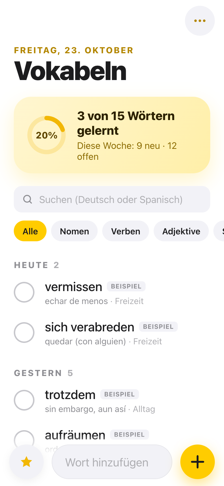
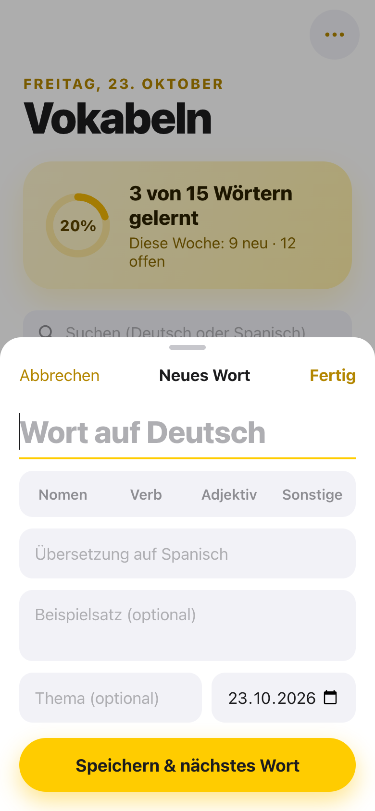
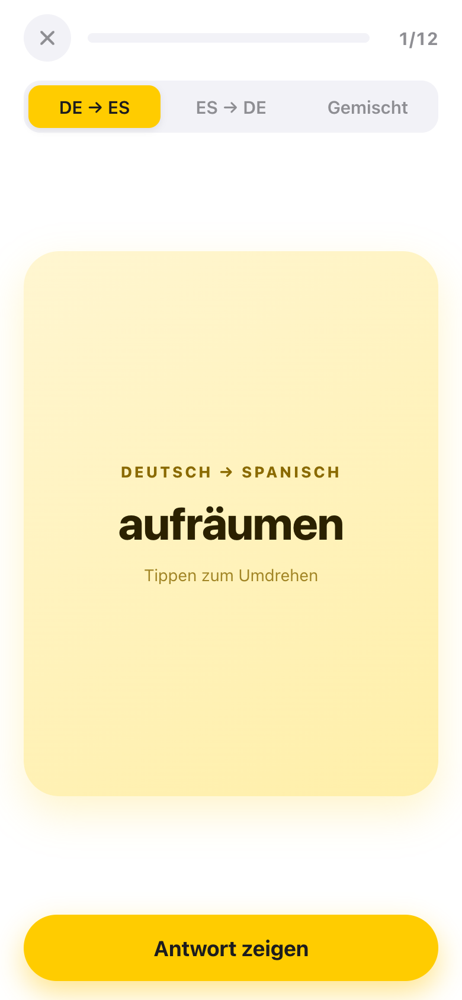
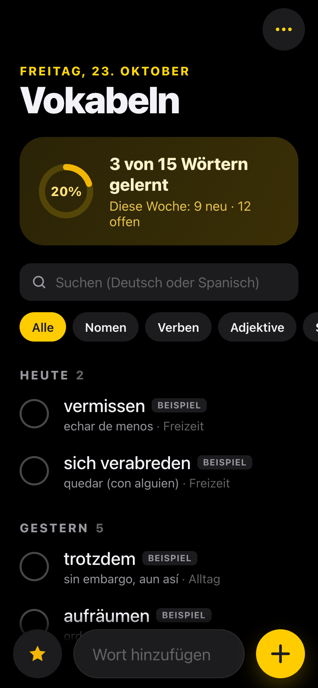

# Vokabeln 🇩🇪 → 🇪🇸

Ein Vokabelheft für den Deutschunterricht: Wörter, die ich im Kurs nicht verstehe, notiere ich in wenigen Sekunden – und wiederhole sie später mit Lernkarten.

**👉 Live: [kharon2001.github.io/vokabeln](https://kharon2001.github.io/vokabeln/)**

<p>
  
  
  
  
</p>

## Was die App kann

- **Schnell notieren** – Wort, Artikel (der/die/das per Tipp), Plural, Übersetzung, Beispielsatz, Thema und Datum. Tippt man „der Hund“, erkennt die App Nomen und Artikel automatisch. „Speichern & nächstes Wort“ hält das Formular für die nächste Vokabel offen.
- **Farben für Artikel** – der = blau, die = rot, das = grün.
- **Suchen & filtern** – auf Deutsch oder Spanisch (auch ohne Umlaute), nach Wortart, Thema und Datum.
- **Bearbeiten, löschen (mit „Rückgängig“) und als „gelernt“ markieren.**
- **Lernkarten** – Deutsch → Spanisch, Spanisch → Deutsch oder gemischt. Falsche Wörter kommen in derselben Runde wieder und später öfter (Leitner-System).
- **Statistik** – Wörter gesamt, gelernt und neu in dieser Woche.
- **Backup** – Export und Import als JSON-Datei.
- **Offline, ohne Konto** – alle Daten bleiben auf dem Handy (localStorage). Hell- und Dunkelmodus.

Beim ersten Start sind 15 Beispielwörter dabei (markiert mit „Beispiel“); sie lassen sich über das Menü ⋯ entfernen.

## Technik

Reines HTML, CSS und JavaScript – ohne Framework und ohne Build-Schritt. Eine Progressive Web App mit Service Worker (Offline-Cache) und Web-App-Manifest, gehostet auf GitHub Pages. Das Design gehört zur selben Familie wie meine App [Compras](https://github.com/Kharon2001/compras).

```
index.html            Aufbau der Oberfläche
styles.css            Design (Hell/Dunkel)
app.js                Logik: Speichern, Filter, Lernkarten, Backup
sw.js                 Offline-Cache
manifest.webmanifest  Installierbare App
```

Lokal starten: `python3 -m http.server` und `http://localhost:8000` öffnen.

## Auf dem iPhone installieren

Link in Safari öffnen → Teilen-Symbol → **„Zum Home-Bildschirm“**.

---

Entwickelt mit Hilfe von [Claude Code](https://claude.com/claude-code).
